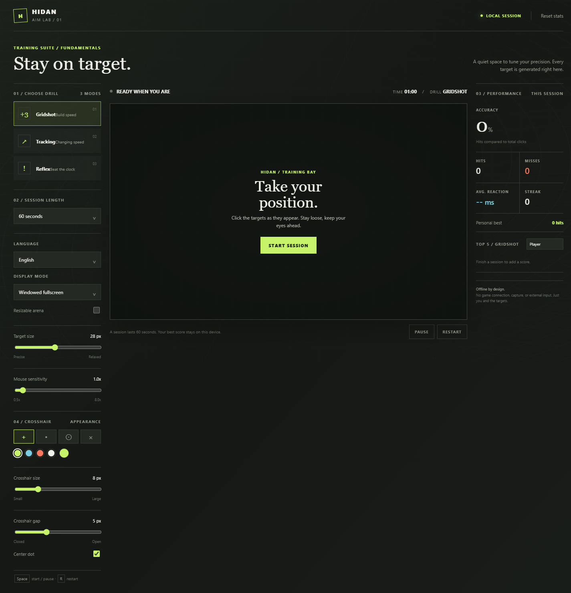
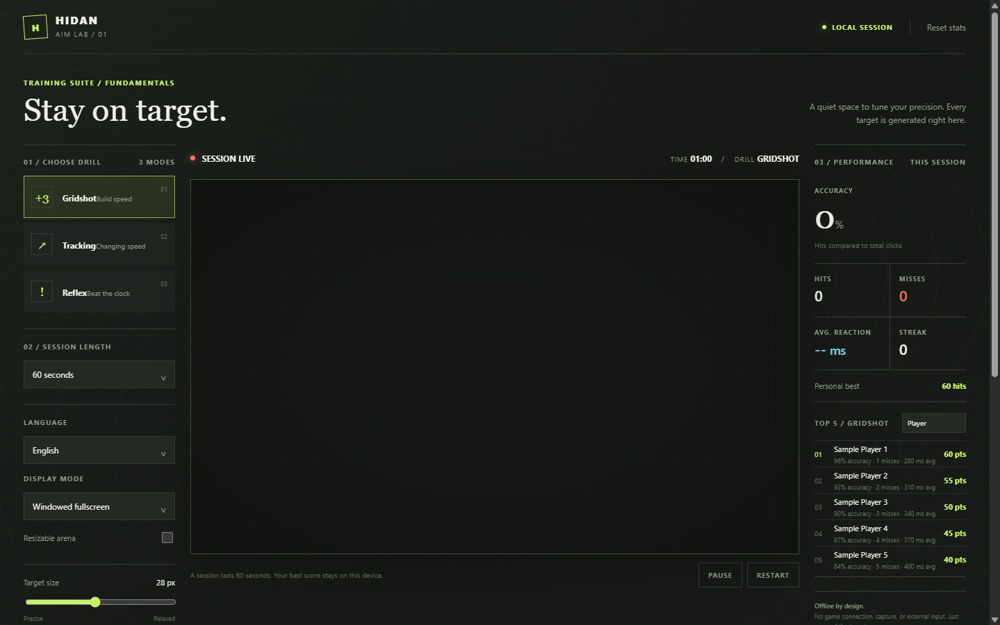

# HIDAN Aim Lab

<p align="center">
	<strong>A focused practice range for cleaner clicks, steadier tracking, and faster reactions.</strong><br>
	Three drills. Your rules. Your data stays on your device.
</p>

<p align="center">
	
</p>

## Find Your Rhythm

HIDAN is a lightweight aim trainer with a quiet, purpose-built range and no game integrations. Start a short session, follow targets across the arena, and review the numbers that matter to your practice.

<p align="center">
	
</p>

## Three Drills

| Drill | Practice focus | Score |
| --- | --- | --- |
| **Gridshot** | Move between three generated targets | Hits, accuracy, reaction time, streak |
| **Tracking** | Follow a target that roams the full arena and changes speed | On-target time, tracking accuracy, best streak |
| **Reflex** | Click targets before they teleport | Hits, accuracy, reaction time |

Sessions run for 30, 60, or 90 seconds. Tune target size and Reflex marker speed, then compare accuracy, misses, reaction time, and score in a local top-five leaderboard for each drill. The Windows app writes leaderboard records to `%LOCALAPPDATA%\HIDAN\leaderboard.json`; browser runs use local storage.

## Make It Yours

- Choose Cross, Dot, Ring, or X reticle styles with preset or custom colors.
- Adjust reticle size and gap, toggle its center dot, and tune mouse sensitivity up to 8×.
- Switch between English and Spanish from inside the app.
- Choose Windowed, Windowed Fullscreen, or Fullscreen in the Windows desktop build (`F11` toggles fullscreen). Resize the practice arena horizontally and vertically.
- Your player name, scores, and preferences are saved locally. Nothing is uploaded or transmitted.

## Run HIDAN

**Browser:** open `index.html` in a current browser. No server or package install is needed.

**Windows desktop:** build from the repository root with .NET 10:

```powershell
dotnet publish .\desktop\Hidan.Desktop\Hidan.Desktop.csproj -c Release -r win-x64 --self-contained true -p:DebugType=None -o .\publish\win-x64
```

Launch `publish\win-x64\HIDAN.exe`. The app uses the Microsoft Edge WebView2 Runtime, which is included with most current Windows installations. The desktop app stores leaderboard data at `%LOCALAPPDATA%\HIDAN\leaderboard.json` and browser preferences in its local WebView2 profile.

## Keyboard

- `Space`: start or pause
- `R`: restart
- `F11`: toggle fullscreen in the Windows desktop app

## Privacy By Design

Targets are synthetic and practice runs stay local. HIDAN does not capture the screen, inspect other processes, connect to games, automate external input, or send player data to a server.
